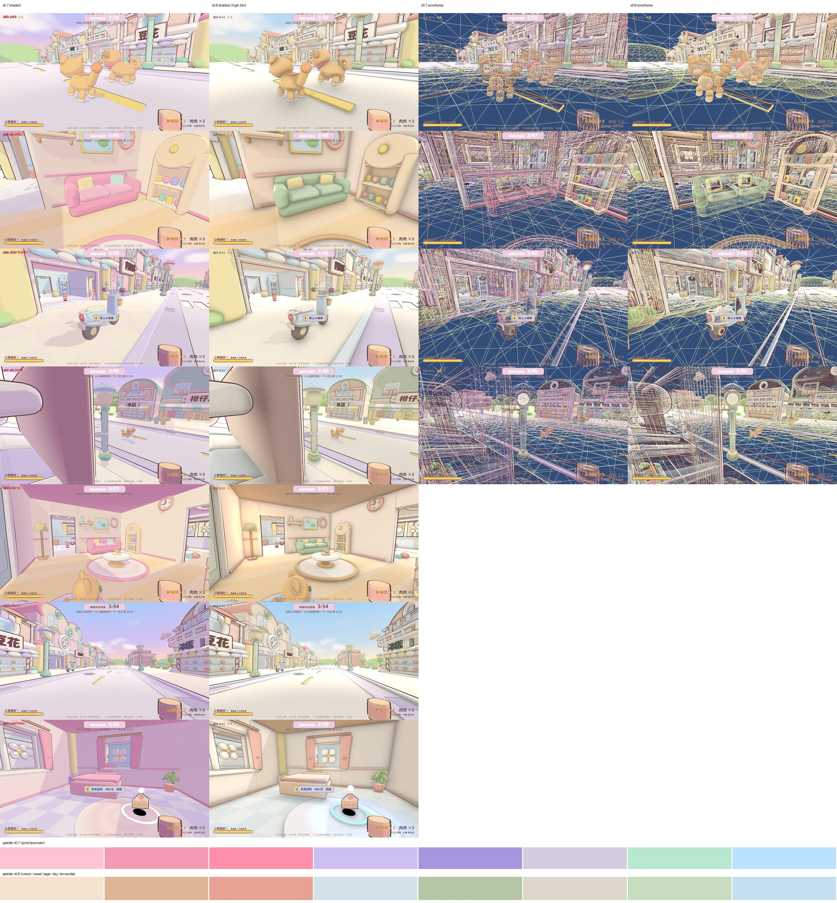

# 極速撤離 Extract — 休閒版（Unity）

一款粉蠟筆風格的「搜刮撤離」小遊戲：潛入阿姨家搜刮零食，用罐頭和肉肉安撫貓狗，在時間內趕上公車撤離回家！

**▶ 線上試玩（WebGL）：https://hl2dm.github.io/extract-unity/**
（第一次載入約 110 MB，建議使用桌機版 Chrome / Edge / Firefox。）

Windows 版下載：見 [Releases](https://github.com/hl2dm/extract-unity/releases)。

## v0.8 更新：更高面數 + 光影 + 療癒色盤

- **3D 模型面數**：SoftKit 程序化模型（寵物、角色、機車、家具、立面、樹、路燈、溜滑梯）依畫質分級細分；高畫質約 4.3 倍三角形（場景 1.65M → 7.13M），中畫質約 2.1 倍（3.40M），低畫質與 v0.7 相同。分級 = min(平台上限, F8 畫質)：Windows 高／WebGL 中／手機低。
- **光影**：柔和陰影（4096/4 cascade @高）、SSAO、暖主光 + 冷補光、柔和 bloom、檯燈／窗戶光暈、角色邊緣光、霧、調色；全部依畫質分級。
- **色盤**：降低粉紅／淡紫，改為奶油、暖木、鼠尾草綠、淡天藍、奶油黃、陶土色，粉紅只作點綴；移除偏紫的光線與調色。
- 效能（Windows 1280×720，同次量測）：街道 21.1 → 22.7 ms，客廳 13.0 → 14.0 ms。
- Claude 審查：7 → 7 → 7 → 7 → 8/10（見 review/v08）。

## 操作方式
| 按鍵 | 動作 |
|---|---|
| W A S D | 移動 |
| 滑鼠 | 轉動視角 |
| Shift | 跑步 |
| 空白鍵 | 跳躍 / 結算畫面返回基地 / 跳過過場 |
| E | 互動（搜刮、開門、上公車） |
| 1 / 2 或滾輪 | 切換罐頭 / 肉肉 |
| 滑鼠左鍵 | 丟出罐頭或肉肉（安撫、引開貓狗） |
| F | 搜刮時全部拿走 |
| Q | 搜刮時付費跳過等待 |
| Esc | 放開滑鼠 / 跳過過場 |
| F8 | 切換反鋸齒畫質（低 / 中 / 高） |

### 手機 / 平板觸控（v0.6）
- 左半邊：虛擬搖桿移動；右半邊：滑動轉視角
- 右下按鈕：互動、跳、丟、跑、換零食；騎機車時改為「往後」「視角」
- 搜刮畫面直接點物品拿取；提示框可直接點擊互動
- 網頁版全視窗自適應（RWD），右上角 ⛶ 可全螢幕；直向會提示轉成橫向
- 網址加 `?touch=1` 可在電腦上強制開啟觸控介面

> 目前可遊玩的地圖：**阿姨家**。在倒數結束前走到公車站上車即可撤離成功。

## 專案說明
- 引擎：Unity 6（6000.4.8f1），URP。
- 開啟方式：用 Unity Hub 加入此資料夾，開啟 `Assets/Scenes/Bootstrap.unity`。
- 場景幾乎全部由程式產生（`Assets/Scripts/SoftKit.cs`、`SoftProps.cs`、`AuntMap.cs`），風格著色器在 `Assets/Resources/Shaders/`。
- `review/`：美術方向、評審與迭代紀錄。

## 授權與素材來源
素材來源請見 [CREDITS.md](CREDITS.md) 與 `Assets/Licenses/`。第三方素材皆為 CC0 或 SIL OFL 1.1（字型）。
